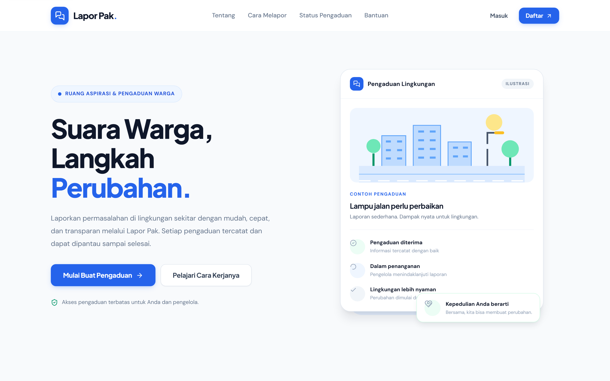
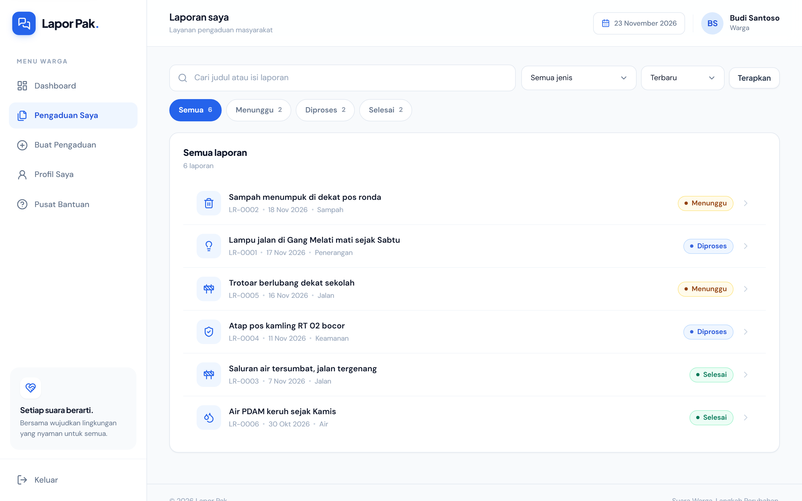
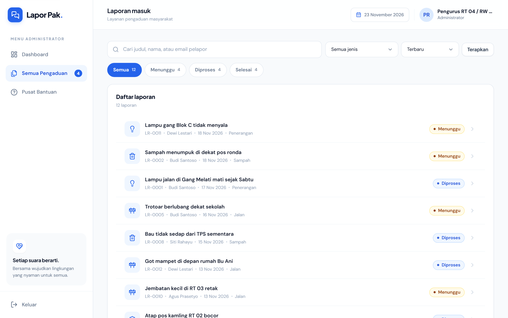

# LAPORAN

## Nama Proyek

**Lapor Pak** — Portal Pengaduan Warga RT
*Suara Warga, Langkah Perubahan*

## Ringkasan Singkat

Lapor Pak adalah aplikasi berbasis web yang menjadi saluran resmi bagi warga untuk menyampaikan masalah di lingkungan tempat tinggal, seperti sampah menumpuk, lampu jalan mati, jalan berlubang, atau saluran air tersumbat.

Warga cukup membuka alamat situs melalui ponsel atau komputer, tanpa perlu memasang aplikasi tambahan. Setiap laporan tercatat dengan nomor, tersimpan beserta foto bukti, dan dapat dipantau perkembangannya. Pengurus RT menerima seluruh laporan dalam satu halaman kerja, menuliskan tindak lanjut, lalu memperbarui statusnya sampai masalah benar-benar selesai.

Tujuan utamanya sederhana: tidak ada lagi keluhan warga yang hilang di tengah percakapan grup pesan, dan tidak ada lagi laporan yang tidak jelas sudah ditangani atau belum.

## Detail Deskripsi Proyek

### Latar Belakang

Selama ini keluhan warga biasanya disampaikan secara lisan, lewat pesan pribadi, atau di grup percakapan lingkungan. Cara ini punya beberapa kelemahan:

- Laporan mudah tenggelam oleh percakapan lain sehingga terlupakan.
- Sulit diketahui apakah sebuah masalah sudah ditangani atau belum.
- Pengurus tidak memiliki rekap yang rapi tentang apa saja yang pernah dilaporkan.
- Warga tidak punya bukti kapan laporan disampaikan dan bagaimana tanggapannya.

Lapor Pak menjawab hal tersebut dengan menyediakan satu tempat khusus untuk mencatat, menindaklanjuti, dan memantau pengaduan warga.

### Untuk Siapa

| Pengguna | Peran |
| --- | --- |
| Warga | Melaporkan masalah, memantau laporan sendiri, dan mengelola profil |
| Pengurus RT | Meninjau seluruh laporan, menulis catatan tindak lanjut, dan memperbarui status |
| Pengunjung umum | Membaca penjelasan tentang layanan dan panduan cara melapor |

### Cara Kerja

1. **Mendaftar.** Warga membuat akun dengan nama, email, nomor WhatsApp, dan alamat.
2. **Melapor.** Warga memilih jenis masalah, menuliskan judul dan uraian, mengisi tanggal kejadian, lalu melampirkan foto sebagai bukti.
3. **Menunggu.** Laporan masuk ke antrean pengurus dengan status **Menunggu**.
4. **Ditindaklanjuti.** Pengurus meninjau laporan, menuliskan catatan (misalnya hasil pengecekan atau rencana perbaikan), lalu mengubah status menjadi **Diproses**.
5. **Selesai.** Setelah masalah tertangani, pengurus menandai laporan sebagai **Selesai** dan menuliskan hasil akhirnya.
6. **Dipantau.** Warga dapat membuka kembali laporannya kapan saja untuk melihat status dan catatan terbaru dari pengurus.

### Arti Status Laporan

| Status | Arti |
| --- | --- |
| **Menunggu** | Laporan sudah diterima dan masih dalam antrean pengurus |
| **Diproses** | Pengurus sedang menindaklanjuti laporan |
| **Selesai** | Masalah sudah ditangani dan hasilnya sudah dicatat |

Status bergerak maju satu langkah setiap kali diperbarui. Tahap **Selesai** merupakan tahap akhir, namun pengurus masih dapat menambahkan catatan apabila diperlukan.

### Jenis Laporan yang Dapat Disampaikan

- **Kebersihan & Sampah** — sampah menumpuk, tempat pembuangan penuh, bau tidak sedap
- **Lampu & Penerangan** — lampu jalan mati, penerangan gang padam
- **Jalan & Drainase** — jalan berlubang, got tersumbat, banjir
- **Keamanan & Ketertiban** — pos ronda rusak, aktivitas mencurigakan
- **Air & Sanitasi** — air keruh, saluran air bermasalah
- **Lainnya** — fasilitas umum rusak atau masalah lain di lingkungan

### Fitur Utama

**Bagi warga**

- Membuat laporan lengkap dengan foto bukti
- Melihat riwayat seluruh laporan pribadi dalam satu daftar
- Mencari laporan dan menyaringnya berdasarkan status maupun jenis masalah
- Mengubah atau menghapus laporan selama statusnya masih **Menunggu**
- Melihat ringkasan pada beranda: jumlah laporan, jumlah yang masih menunggu, sedang diproses, dan sudah selesai
- Melihat grafik jumlah laporan dalam 7, 14, atau 30 hari terakhir serta persentase laporan yang tuntas
- Mengubah data profil dan kata sandi

**Bagi pengurus RT**

- Melihat ringkasan kondisi lingkungan, termasuk laporan yang paling lama menunggu
- Membuka seluruh laporan warga dengan pencarian dan penyaringan
- Menulis catatan tindak lanjut yang langsung terbaca oleh pelapor
- Memperbarui status laporan satu langkah setiap kali
- Melihat identitas pelapor beserta kontak yang dapat dihubungi

**Bagi pengunjung umum**

- Halaman beranda yang menjelaskan layanan, manfaat, dan cara melapor
- Pusat bantuan berisi panduan penggunaan serta informasi kontak pengurus

### Keamanan dan Privasi

- Laporan hanya dapat dibuka oleh warga yang membuatnya dan oleh pengurus RT. Warga lain tidak dapat melihat laporan orang lain.
- Foto bukti tidak dapat diakses langsung melalui alamat umum. Akses foto diperiksa terlebih dahulu agar hanya pihak yang berhak dapat melihatnya.
- Halaman publik tidak menampilkan isi laporan maupun data pribadi warga.
- Peran pengguna tidak dapat diubah sendiri melalui formulir, dan status laporan hanya dapat diubah oleh pengurus.
- Proses masuk dan pendaftaran dibatasi untuk mencegah percobaan berulang yang tidak wajar.

### Gambaran Tampilan

**Beranda publik** — penjelasan layanan dan ajakan melapor.

**Daftar pengaduan warga** — seluruh laporan pribadi beserta statusnya.

**Panel pengurus** — antrean laporan dari seluruh warga.

### Catatan Teknis Singkat

Aplikasi ini dibangun dengan kerangka kerja Laravel dan dapat dijalankan pada server web biasa. Data laporan, akun, dan foto disimpan di server, sehingga warga tidak perlu memasang apa pun di perangkatnya. Tampilan menyesuaikan ukuran layar, baik digunakan melalui ponsel maupun komputer.

### Batasan Saat Ini

- Laporan yang sudah ditinjau tidak dapat diubah lagi oleh warga; koreksi dilakukan melalui pengurus.
- Status hanya dapat bergerak maju satu langkah dan tidak dapat dikembalikan.
- Aplikasi tidak mengirim pemberitahuan otomatis. Warga perlu membuka kembali laporannya untuk melihat pembaruan.
- Belum tersedia fitur unduh rekap laporan dalam bentuk berkas.

### Isi Folder Dokumentasi

| Berkas | Keterangan |
| --- | --- |
| `thumbnail.png` | Gambar utama untuk tampilan repositori atau pratinjau proyek |
| `01-beranda.png` | Tangkapan layar halaman beranda publik |
| `02-pengaduan-saya.png` | Tangkapan layar daftar pengaduan milik warga |
| `03-panel-pengurus.png` | Tangkapan layar panel pengurus RT |
| `LAPORAN.md` | Dokumen ini |
